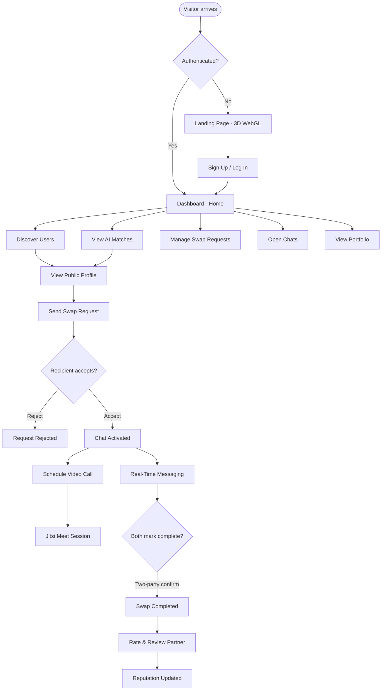
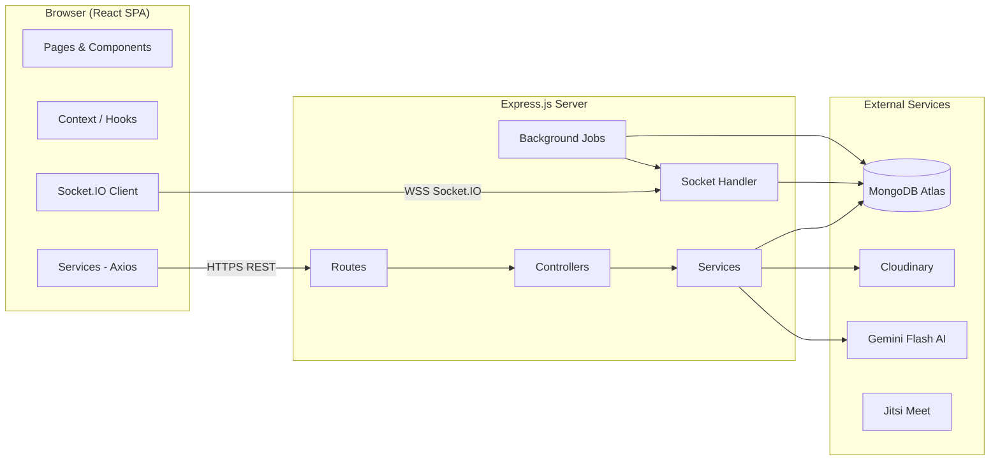
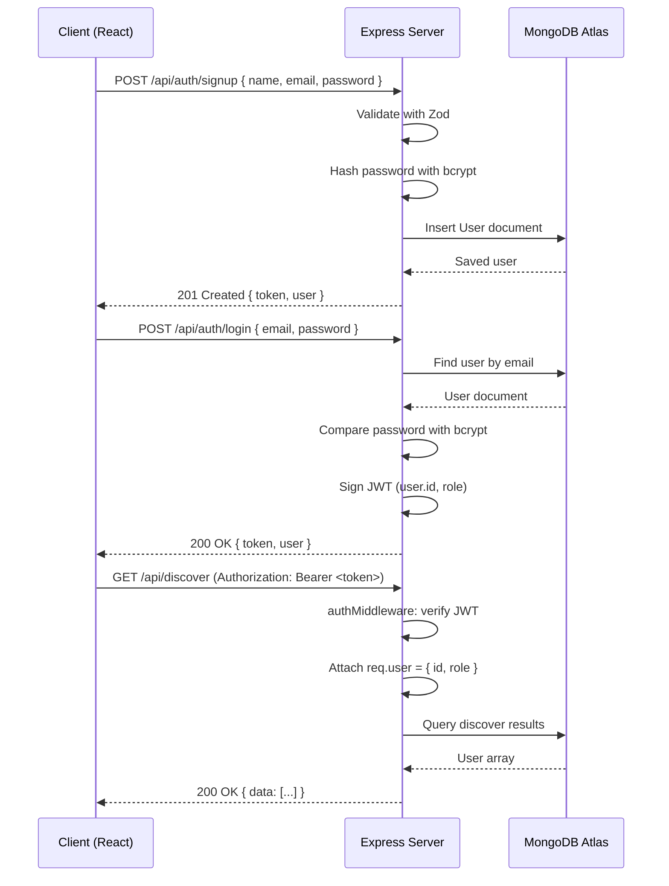
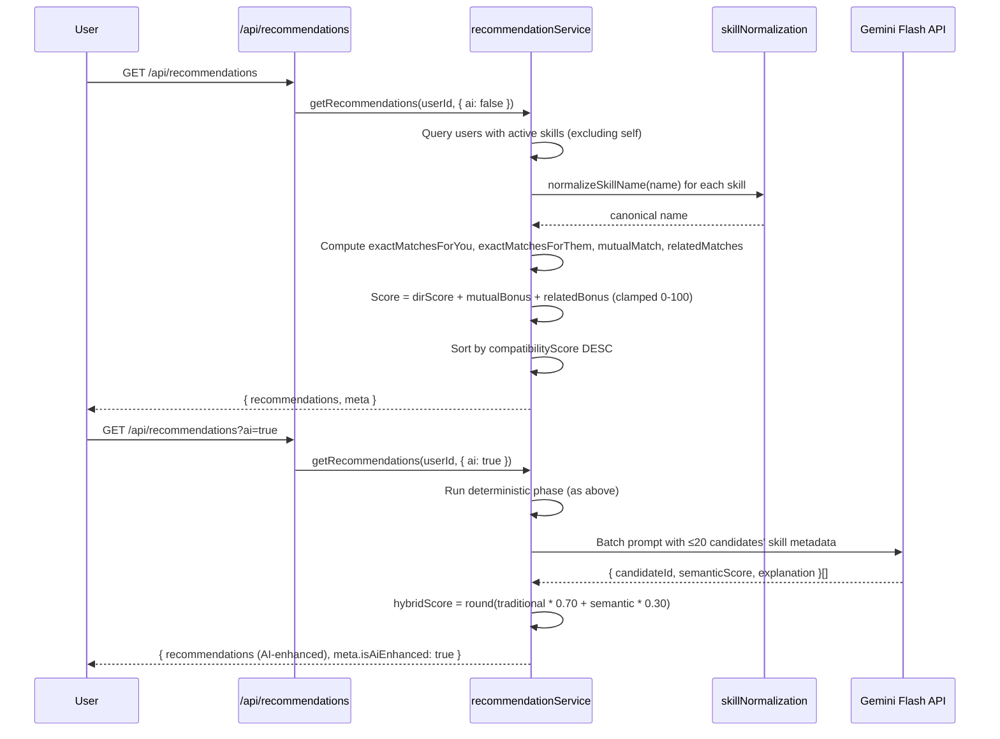
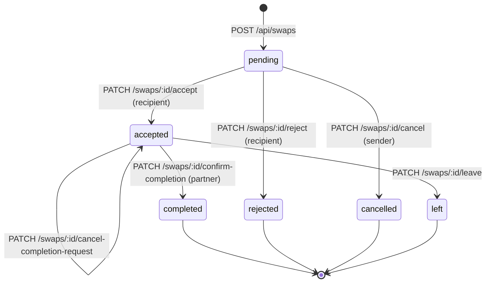

# 03 — System Design

## SkillSwap — Architecture and Design

---

## 1. High-Level Architecture

SkillSwap uses a **monolithic backend** pattern with a **decoupled frontend SPA**. A single Express.js server handles all REST routes, WebSocket (Socket.IO) connections, background jobs, and third-party integrations. The React SPA is deployed as a static build and communicates with the backend over HTTPS (REST) and WSS (Socket.IO).

```
┌──────────────────────────┐           HTTPS / REST           ┌───────────────────────────────┐
│   React 19 SPA           │ ────────────────────────────────▶ │   Express.js v5 Server        │
│   (Vercel – static)      │ ◀──────────────────────────────── │   (Render – monolith)         │
│                          │         WebSocket (WSS)           │                               │
│                          │ ◀──────────────────────────────▶  │   • REST API (/api/...)       │
└──────────────────────────┘                                   │   • Socket.IO (chat, events)  │
                                                               │   • Background jobs           │
                                                               └───────────┬───────────────────┘
                                    ┌──────────────────────────────────────┼──────────────────┐
                                    ▼                                      ▼                  ▼
                           ┌────────────────┐                 ┌─────────────────┐   ┌───────────────┐
                           │ MongoDB Atlas  │                 │   Cloudinary    │   │  Jitsi Meet   │
                           │ (9 collections)│                 │ (Images/Videos) │   │ (WebRTC video)│
                           └────────────────┘                 └─────────────────┘   └───────────────┘
                                                                       ▲
                                                              ┌──────────────────┐
                                                              │ Google Gemini    │
                                                              │ Flash AI API     │
                                                              └──────────────────┘
```

---

## 2. Architecture Principles

| Principle | Implementation |
|---|---|
| **Thin routes, fat services** | Controllers handle HTTP request/response; all business logic lives in `services/` |
| **Stateless API** | JWT-based auth; no server-side session store |
| **External services for heavy lifting** | Cloudinary for media, Jitsi for video — no self-hosted infrastructure |
| **Additive AI layer** | Gemini AI sits on top of deterministic matching as a re-ranking step; system degrades gracefully if AI fails |
| **Simplicity over premature optimisation** | Monolith over microservices; correctness and working end-to-end flow over theoretical scale |

---

## 3. Frontend Architecture

### Technology Stack
| Technology | Version | Purpose |
|---|---|---|
| React | 19.x | UI component framework |
| Vite | 8.x | Build tool and dev server |
| Tailwind CSS | v4.x | Utility-first CSS framework |
| Three.js | 0.186 | 3D WebGL landing page scene |
| React Router DOM | v7.x | Client-side routing |
| Axios | 1.18 | HTTP client with interceptors |
| Socket.IO Client | v4.x | Real-time WebSocket client |
| Lucide React | 1.27 | Icon library |
| react-easy-crop | 6.x | Image cropping UI |

### Folder Structure

```
client/src/
├── pages/           # 13 route-level page components
├── components/      # Reusable UI components
│   ├── chat/        # ChatHeader, MessageList, MessageBubble, MessageInput, ConversationList
│   ├── dashboard/   # DashboardHero, DashboardStats, ActiveSwapsSection, etc.
│   ├── discover/    # DiscoverCard, FilterPanel, SearchBar, Pagination
│   ├── icons/       # OfferedSkillIcon, WantedSkillIcon, MatchesIcon
│   ├── landing/     # Cinematic3DScene, LandingSpatialHUD, LandingNavbar
│   ├── layout/      # AppLayout, MobileBottomNav
│   ├── meetings/    # JitsiMeetingModal, MeetingMessageCard, ScheduleMeetingModal
│   ├── notifications/ # NotificationBell, NotificationItem
│   ├── portfolio/   # PortfolioCard, PortfolioLightbox, PortfolioUploadModal
│   ├── profile/     # CompactProfileStats, ReviewCard, ReviewsSection
│   ├── recommendations/ # RecommendationCard, RecommendationSkeleton
│   └── swaps/       # SwapRequestCard, SwapRequestModal, RatingModal
├── context/         # AuthContext, SocketContext, ThemeContext, SwapContext, NotificationContext
├── hooks/           # useAuth, useDiscover, useSocket, useNotifications, useTheme
├── services/        # Axios service wrappers per domain
└── utils/           # dateUtils, swapSortUtils
```

### State Management
- **AuthContext**: Holds the authenticated user object and JWT; persisted in memory with a single refresh check on load.
- **SocketContext**: Maintains ONE authenticated Socket.IO connection per session. Exposes `isConnected`, `joinSwapChat`, `sendMessage`, `subscribeToMessages`.
- **SwapContext**: Tracks pending swap counts for Navbar badges.
- **NotificationContext**: Manages live notifications and unread count with MongoDB `_id` deduplication.
- **ThemeContext**: Manages System/Light/Dark theme; persisted to `localStorage` under `skillswap_theme`.

---

## 4. Backend Architecture

### Technology Stack
| Technology | Version | Purpose |
|---|---|---|
| Node.js | v20+ | Server runtime |
| Express.js | v5.x | HTTP framework |
| Mongoose | v9.x | MongoDB ODM |
| Socket.IO | v4.x | WebSocket server |
| Zod | v4.x | Request body validation (primary) |
| Joi | — | Request body validation (secondary, some routes) |
| bcryptjs | 3.x | Password hashing |
| jsonwebtoken | 9.x | JWT signing and verification |
| Cloudinary SDK | v2.x | Cloud media uploads and deletions |
| Multer | v2.x | Multipart file handling |
| @google/genai | 2.19 | Gemini Flash API client |
| dotenv | 17.x | Environment variable loading |
| nodemon | 3.x | Development auto-reload |

### Folder Structure

```
server/src/
├── config/       # db.js (MongoDB Atlas connection), cloudinary.js (upload/delete helpers)
├── constants/    # skillConstants.js (categories, levels, types, statuses)
├── controllers/  # HTTP controllers (thin: validate → service → respond)
├── jobs/         # meetingReminderJob.js (background scheduler)
├── middleware/   # authMiddleware.js, errorHandler.js, uploadMiddleware.js, validateRequest.js
├── models/       # 9 Mongoose schemas (User, Skill, SwapRequest, Message, MeetingSession, Rating, Notification, Portfolio, PortfolioReport)
├── routes/       # 12 route files (auth, profile, users, skills, discover, swaps, chat, notifications, ratings, portfolio, recommendations, meetings)
├── services/     # Business logic services
├── sockets/      # socketHandler.js — Socket.IO connection handler and chat event logic
└── utils/        # skillNormalization, authValidation, chatValidation, etc.
```

### Layering Rule
```
HTTP Request → Route → Controller → Service → Model/DB → Response
                                       ↓
                                  Utils / External APIs
```

---

## 5. Database Architecture

MongoDB Atlas with 9 collections accessed via Mongoose:

| Collection | Purpose |
|---|---|
| `users` | User accounts, profiles, and auto-calculated stats |
| `skills` | Per-user skill records (offered or wanted) |
| `swaprequests` | Swap lifecycle with status state machine |
| `messages` | Chat messages (text and meeting-card types) |
| `meetingsessions` | Video session records |
| `ratings` | Post-swap star ratings and reviews |
| `notifications` | In-app notification records |
| `portfolios` | Portfolio media items with reactions |
| `portfolioreports` | Moderation reports on portfolio items |

---

## 6. Key Data Flow Diagrams

### 6.1 Application Flowchart



### 6.2 System Architecture Diagram



---

## 7. Authentication and Authorization Flow



---

## 8. Skill Discovery and Matching Flow



---

## 9. Swap Request and Chat Workflow



---

## 10. Real-Time Layer (Socket.IO)

The Socket.IO server runs **on the same HTTP server instance** as Express — no separate process. Rooms are keyed as:

| Room Key | Purpose |
|---|---|
| `swap:<swapId>` | Isolated chat communications, meeting card updates |
| `user:<userId>` | Real-time swap status events, notifications, unread badge sync |

### Socket Events

**Client → Server:**
| Event | Payload | Response |
|---|---|---|
| `join_swap_chat` | `{ swapId }` | Joins room `swap:<swapId>`; verifies JWT + swap membership |
| `send_message` | `{ swapId, content, replyTo? }` | Persists message, broadcasts to room |
| `mark_messages_read` | `{ swapId, messageIds }` | Updates status to `read`, broadcasts status update |

**Server → Client:**
| Event | Target | Payload |
|---|---|---|
| `new_message` | `swap:<swapId>` | Saved message document |
| `messages_status_update` | `swap:<swapId>` | `{ type, swapId, readBy, readAt }` |
| `message_deleted` | `swap:<swapId>` | `{ swapId, messageId, deletedAt }` |
| `chat_unread_update` | `user:<userId>` | `{ swapId, unreadConversationCount, totalUnreadMessageCount }` |
| `swap_request_created` | `user:<userId>` | New swap request document |
| `swap_request_updated` | `user:<userId>` | Updated swap request document |
| `notification` | `user:<userId>` | Notification document + `unreadCount` |
| `notification_unread_update` | `user:<userId>` | `{ unreadCount }` |
| `meeting_updated` | `swap:<swapId>` | Updated meeting session |

---

## 11. Background Jobs

### Meeting Reminder Job (`meetingReminderJob.js`)

- **Polling interval**: every 30 seconds.
- **Logic**: Finds `MeetingSession` documents where:
  - `status: "scheduled"` and `scheduledAt` is within the next 15 minutes and `reminded15m: false` → sends 15-minute reminder notification, sets `reminded15m: true` (atomic `findOneAndUpdate`).
  - `status: "scheduled"` and `scheduledAt` has passed and `remindedStart: false` → sends start-time notification, sets `remindedStart: true`.
- **Idempotency**: The atomic update prevents duplicate notifications across server restarts or multiple processes.

---

## 12. Cloudinary Integration

| Upload Function | Folder | Media Types | Size Limit |
|---|---|---|---|
| `uploadToCloudinary` | `skillswap/profiles` | Images (jpg, png, webp) | ≤10 MB |
| `uploadPortfolioToCloudinary` | `skillswap/portfolio/images` or `skillswap/portfolio/videos` | Images (≤10 MB), Videos (≤50 MB, ≤60s) | Per type |

**Cleanup lifecycle**: When a profile picture or banner is replaced, the old asset's `publicId` is used to call `cloudinary.uploader.destroy()` after the database update succeeds. Portfolio deletions also trigger Cloudinary cleanup after the 5-second undo window expires without an undo action.

---

## 13. Deployment Topology

| Layer | Platform | Notes |
|---|---|---|
| Frontend | Vercel | Auto-deploy from repo; static build |
| Backend | Render | Express + Socket.IO; single instance |
| Database | MongoDB Atlas | Free-tier cluster |
| Media | Cloudinary | Free-tier |
| Environment secrets | Render + Vercel env vars | Never committed to Git |

---

*Document verified against source code: `c:\SkillSwap\` — October 2026.*

