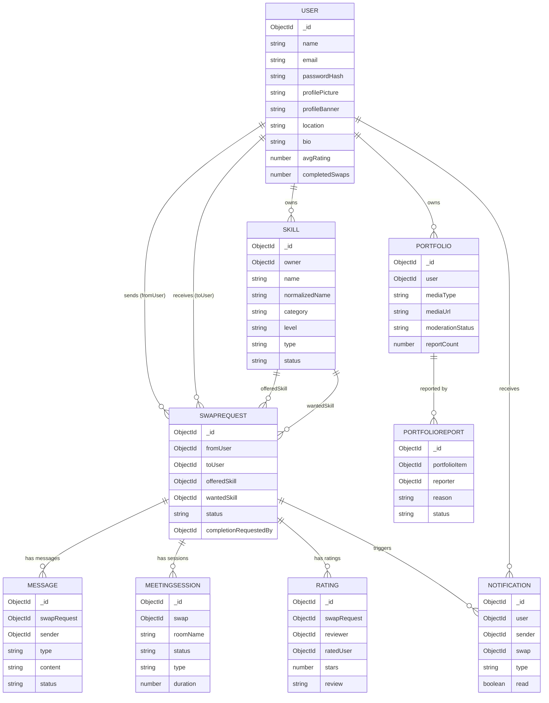

# 04 — Database Design

## SkillSwap — MongoDB Schema Reference

> All schemas are verified against the Mongoose model files in `server/src/models/`.  
> Database: **MongoDB Atlas** (free-tier cluster) · ODM: **Mongoose v9**

---

## 1. Collections Overview

| Collection | Model File | Purpose |
|---|---|---|
| `users` | `User.js` | Accounts, profiles, auto-stats |
| `skills` | `Skill.js` | Per-user skill records |
| `swaprequests` | `SwapRequest.js` | Swap lifecycle and state machine |
| `messages` | `Message.js` | Chat messages (text + meeting cards) |
| `meetingsessions` | `MeetingSession.js` | Video meeting records |
| `ratings` | `Rating.js` | Post-swap star ratings and reviews |
| `notifications` | `Notification.js` | In-app notification records |
| `portfolios` | `Portfolio.js` | Portfolio media items with reactions |
| `portfolioreports` | `PortfolioReport.js` | Moderation reports |

---

## 2. Collection: `users`

**Model file:** [`server/src/models/User.js`](file:///c:/SkillSwap/server/src/models/User.js)

```
users
├── _id              ObjectId       Auto-generated primary key
├── name             String         Required, trimmed, indexed
├── email            String         Required, unique, lowercase, trimmed, indexed
├── passwordHash     String         Required — bcrypt hash (never plaintext)
├── profilePicture   String         Cloudinary secure URL, default: ""
├── profilePicturePublicId  String  Cloudinary public_id for safe deletion, default: ""
├── profileBanner    String         Cloudinary secure URL, default: ""
├── profileBannerPublicId   String  Cloudinary public_id for safe deletion, default: ""
├── location         String         City only (e.g. "Bangalore"), default: "", indexed
├── bio              String         Max 160 chars, trimmed, default: ""
├── socialLinks
│   ├── linkedin     String         Full URL, default: ""
│   ├── github       String         Full URL, default: ""
│   ├── instagram    String         Full URL, default: ""
│   ├── youtube      String         Full URL, default: ""
│   └── website      String         Full URL, default: ""
├── role             String         Enum: ["user", "admin"], default: "user"
├── portfolio        [SubDocument]  Legacy embedded array (see Note below)
│   ├── type         String         Enum: ["image", "video"]
│   ├── url          String         Cloudinary URL
│   ├── caption      String         default: ""
│   ├── linkedSkill  ObjectId       ref: Skill, default: null
│   └── createdAt    Date           default: Date.now
├── avgRating        Number         Server-managed, default: 0 (1 decimal place)
├── completedSwaps   Number         Server-managed, default: 0
├── createdAt        Date           Mongoose timestamps
└── updatedAt        Date           Mongoose timestamps
```

**Note on `portfolio` array:** The `User` schema still contains a legacy `portfolio` embedded array. Active portfolio management (Phase 9+) uses the standalone `Portfolio` collection. The embedded array is preserved for backward compatibility.

**Indexes:**
- `email` — unique index
- `name` — single-field index
- `location` — single-field index (supports location-based discovery)

**Server-managed fields:** `avgRating` and `completedSwaps` are updated exclusively by `ratingService.js` and `swapService.js`. The profile update endpoint (`PUT /api/users/me`) uses a strict field whitelist that excludes these fields.

---

## 3. Collection: `skills`

**Model file:** [`server/src/models/Skill.js`](file:///c:/SkillSwap/server/src/models/Skill.js)

```
skills
├── _id              ObjectId       Auto-generated primary key
├── owner            ObjectId       ref: User — required, indexed
├── name             String         Required, trimmed (user-entered display name)
├── normalizedName   String         Required, lowercase, trimmed, indexed
│                                   (canonical form for matching, e.g. "javascript")
├── category         String         Required, enum: 20 defined categories, indexed
├── level            String         Enum: ["Beginner","Intermediate","Advanced","Expert"]
│                                   default: "Intermediate", indexed
├── type             String         Required, enum: ["Offer","Learn"], indexed
│                                   "Offer" = skill user can teach
│                                   "Learn" = skill user wants to learn
├── description      String         Max 250 chars, default: ""
├── yearsOfExperience Number        Min 0, max 50, default: null
├── status           String         Enum: ["Active","Inactive"], default: "Active", indexed
├── displayOrder     Number         default: 0
├── createdAt        Date           Mongoose timestamps
└── updatedAt        Date           Mongoose timestamps
```

**Indexes:**
- `owner` — single-field index
- `normalizedName` — single-field index
- `category` — single-field index
- `level` — single-field index
- `type` — single-field index
- `status` — single-field index
- `{ owner, type, normalizedName }` — **compound unique index** (prevents duplicate skills of the same type/name per user)
- `{ status, category, type, level, createdAt: -1 }` — **compound index** for optimised discovery queries

**Skill Categories (20 total):**
Programming, Web Development, Mobile Development, AI & Machine Learning, Data Science, Cyber Security, UI/UX Design, Graphic Design, Video Editing, Photography, Music, Languages, Business, Marketing, Finance, Fitness, Cooking, Writing, Communication, Other

---

## 4. Collection: `swaprequests`

**Model file:** [`server/src/models/SwapRequest.js`](file:///c:/SkillSwap/server/src/models/SwapRequest.js)

```
swaprequests
├── _id                     ObjectId    Auto-generated
├── fromUser                ObjectId    ref: User (request sender)
├── toUser                  ObjectId    ref: User (request recipient)
├── offeredSkill            ObjectId    ref: Skill (what sender offers)
├── wantedSkill             ObjectId    ref: Skill (what sender wants from recipient)
├── offeredSkillSnapshot    Object      Immutable snapshot at creation time
│   ├── name                String
│   └── level               String
├── wantedSkillSnapshot     Object      Immutable snapshot at creation time
│   ├── name                String
│   └── level               String
├── offeredSkillName        String      Immutable snapshot of offered skill name
├── offeredSkillLevel       String      Immutable snapshot of offered skill level
├── wantedSkillName         String      Immutable snapshot of wanted skill name
├── wantedSkillLevel        String      Immutable snapshot of wanted skill level
├── message                 String      Optional request message (max 500 chars)
├── status                  String      Enum: ["pending","accepted","rejected",
│                                              "cancelled","completed","left"]
├── leftBy                  ObjectId    ref: User — set when status is "left"
├── completionRequestedBy   ObjectId    ref: User — who initiated completion request
├── completionRequestedAt   Date        When completion was requested
├── completion
│   ├── fromUserConfirmed   Boolean     true when fromUser confirms
│   └── toUserConfirmed     Boolean     true when toUser confirms
├── completedAt             Date        Set when both parties confirm completion
├── endedAt                 Date        Set when swap is completed or left
├── chatDeletedFor          [ObjectId]  Users who deleted this chat from their history
├── hiddenFor               [ObjectId]  Users who hid this swap from lists
├── createdAt               Date        Mongoose timestamps
└── updatedAt               Date        Mongoose timestamps
```

**Indexes:**
- `fromUser`, `toUser`, `status`, `chatDeletedFor` — single-field indexes
- `{ fromUser, toUser, offeredSkill, wantedSkill, status }` — compound index for duplicate request detection
- `{ status, chatDeletedFor }` — compound index for active conversation filtering

---

## 5. Collection: `messages`

**Model file:** [`server/src/models/Message.js`](file:///c:/SkillSwap/server/src/models/Message.js)

```
messages
├── _id              ObjectId    Auto-generated
├── swapRequest      ObjectId    ref: SwapRequest — the authoritative relationship
├── sender           ObjectId    ref: User
├── type             String      Enum: ["text","meeting"], default: "text"
├── content          String      Max 2000 chars (cleared to "" when isDeleted: true)
├── meetingSession   ObjectId    ref: MeetingSession (populated when type === "meeting")
├── isDeleted        Boolean     Soft delete flag, default: false
├── deletedAt        Date        Soft delete timestamp
├── status           String      Enum: ["sent","delivered","read"]
├── deliveredAt      Date        When delivered to recipient socket session
├── readAt           Date        When recipient opened/viewed conversation
├── replyTo          ObjectId    ref: Message (optional reply-to reference)
├── createdAt        Date        Mongoose timestamps
└── updatedAt        Date        Mongoose timestamps
```

**Indexes:**
- `swapRequest` — single-field index
- `{ swapRequest, createdAt: -1 }` — compound index for reverse-chronological history
- `{ swapRequest, createdAt: 1 }` — compound index for forward-chronological rendering
- `{ swapRequest, sender, status }` — compound index for fast unread count queries

---

## 6. Collection: `meetingsessions`

**Model file:** [`server/src/models/MeetingSession.js`](file:///c:/SkillSwap/server/src/models/MeetingSession.js)

```
meetingsessions
├── _id              ObjectId      Auto-generated
├── swap             ObjectId      ref: SwapRequest — required, indexed
├── participants     [ObjectId]    ref: User (the two accepted swap participants)
├── createdBy        ObjectId      ref: User (session initiator)
├── roomName         String        Deterministic Jitsi room ID: "skillswap-<swapId>-<meetingId>-<random>"
├── scheduledAt      Date          Session start time (default: Date.now for instant)
├── duration         Number        Duration in minutes: 15 | 30 | 45 | 60; default: 30
├── status           String        Enum: ["scheduled","active","completed","cancelled"]
│                                  default: "scheduled"
├── type             String        Enum: ["instant","scheduled"], default: "scheduled"
├── note             String        Optional topic/goal (max 300 chars)
├── reminded15m      Boolean       Reminder flag: 15-minute advance alert sent, default: false
├── remindedStart    Boolean       Reminder flag: start-time alert sent, default: false
├── createdAt        Date          Mongoose timestamps
└── updatedAt        Date          Mongoose timestamps
```

**Indexes:**
- `swap` — single-field index
- `{ swap, status }` — compound index
- `{ participants, status }` — compound index
- `{ status, reminded15m, scheduledAt }` — compound index for background job polling
- `{ status, remindedStart, scheduledAt }` — compound index for background job polling

---

## 7. Collection: `ratings`

**Model file:** [`server/src/models/Rating.js`](file:///c:/SkillSwap/server/src/models/Rating.js)

```
ratings
├── _id              ObjectId    Auto-generated
├── swapRequest      ObjectId    ref: SwapRequest — target completed swap
├── reviewer         ObjectId    ref: User — user submitting the rating
├── ratedUser        ObjectId    ref: User — user receiving the rating
├── stars            Number      Integer 1–5 (required)
├── review           String      Optional text review (max 500 chars)
├── createdAt        Date        Mongoose timestamps
└── updatedAt        Date        Mongoose timestamps
```

**Indexes:**
- `ratedUser` — single-field index (for fetching received reviews)
- `{ swapRequest, reviewer }` — **compound unique index** (enforces max 1 rating per reviewer per swap at the database level)

---

## 8. Collection: `notifications`

**Model file:** [`server/src/models/Notification.js`](file:///c:/SkillSwap/server/src/models/Notification.js)

```
notifications
├── _id              ObjectId    Auto-generated
├── user             ObjectId    ref: User — notification recipient
├── sender           ObjectId    ref: User — action trigger (optional)
├── swap             ObjectId    ref: SwapRequest (optional, required: false)
├── type             String      Enum:
│                                  "swap_request" | "swap_accepted" | "swap_rejected" | "swap_left"
│                                  "completion_request" | "completion_confirmed" | "completion_cancelled"
│                                  "meeting_scheduled" | "meeting_reminder" | "meeting_started" | "meeting_cancelled"
│                                  "rating_received"
├── title            String      Short notification title
├── message          String      Notification body text
├── read             Boolean     default: false
├── createdAt        Date        Mongoose timestamps
└── updatedAt        Date        Mongoose timestamps
```

**Indexes:**
- `{ user, read, createdAt: -1 }` — compound index for fast unread list and count queries

---

## 9. Collection: `portfolios`

**Model file:** [`server/src/models/Portfolio.js`](file:///c:/SkillSwap/server/src/models/Portfolio.js)

```
portfolios
├── _id              ObjectId      Auto-generated
├── user             ObjectId      ref: User — portfolio owner, indexed
├── media
│   ├── url          String        Cloudinary secure delivery URL
│   ├── publicId     String        Cloudinary public_id for deletion management
│   ├── type         String        Enum: ["image","video"]
│   ├── thumbnailUrl String        Video poster / thumbnail URL (null for images)
│   └── duration     Number        Video duration in seconds (max 60; null for images)
├── caption          String        Optional (max 500 chars)
├── skill            ObjectId      ref: Skill — optional linked skill owned by user
├── moderationStatus String        Enum: ["active","reported","hidden","removed"]
│                                  default: "active"
│                                  "active" + "reported" → publicly visible
│                                  "hidden" + "removed" → excluded from public responses
├── reportCount      Number        default: 0
├── reactions        [SubDocument] Subdocument array (1 active reaction per user)
│   ├── user         ObjectId      ref: User (required)
│   ├── type         String        Enum: ["like","impressive","great_work","creative"]
│   └── createdAt    Date          default: Date.now
├── createdAt        Date          Mongoose timestamps
└── updatedAt        Date          Mongoose timestamps
```

**Limits enforced at application layer:** 20 images, 10 videos, 30 total items per user.

**Indexes:**
- `user` — single-field index
- `{ user, moderationStatus, "media.type", createdAt: -1 }` — compound index for optimised user portfolio retrieval with filtering

---

## 10. Collection: `portfolioreports`

**Model file:** [`server/src/models/PortfolioReport.js`](file:///c:/SkillSwap/server/src/models/PortfolioReport.js)

```
portfolioreports
├── _id              ObjectId    Auto-generated
├── portfolioItem    ObjectId    ref: Portfolio — the reported item, indexed
├── reporter         ObjectId    ref: User — the reporting user, indexed
├── reason           String      Required, enum:
│                                  ["nudity","violence","illegal","hate_harassment",
│                                   "spam","copyright","other"]
├── description      String      Optional explanation (max 500 chars, default: "")
├── status           String      Enum: ["pending","reviewed","dismissed","action_taken"]
│                                default: "pending"
├── createdAt        Date        Mongoose timestamps
└── updatedAt        Date        Mongoose timestamps
```

**Indexes:**
- `portfolioItem` — single-field index
- `reporter` — single-field index
- `{ portfolioItem, reporter }` — **compound unique index** (prevents duplicate reports per user per item)

---

## 11. Entity-Relationship Diagram



---

## 12. Auto-Calculated Fields

| Field | Collection | Calculation |
|---|---|---|
| `User.avgRating` | `users` | `Rating.aggregate({ $match: { ratedUser: userId }, $group: { avg: { $avg: "$stars" } } })` — rounded to 1 decimal place. Computed in `ratingService.js` after every `Rating` insert. |
| `User.completedSwaps` | `users` | Incremented by 1 for **both** participants when `PATCH /api/swaps/:id/confirm-completion` succeeds. Computed in `swapService.js`. |

Neither field can be set directly by any client request. The profile update endpoint uses a strict field whitelist.

---

## 13. Scalability Notes

- Referencing `Skill` by `ObjectId` instead of embedding free-text names keeps matching queries exact and prevents data duplication.
- Compound indexes on high-traffic paths (messages per room, notifications per user, portfolio per user) keep read performance stable as data grows.
- Portfolio items are stored as separate documents (not embedded in `User`) to allow independent media scaling, pagination, and moderation.
- Atomic `findOneAndUpdate` operations are used in the completion confirmation and meeting reminder flows to prevent race conditions.

---

*Schema details verified against model files in `server/src/models/` — October 2026.*

